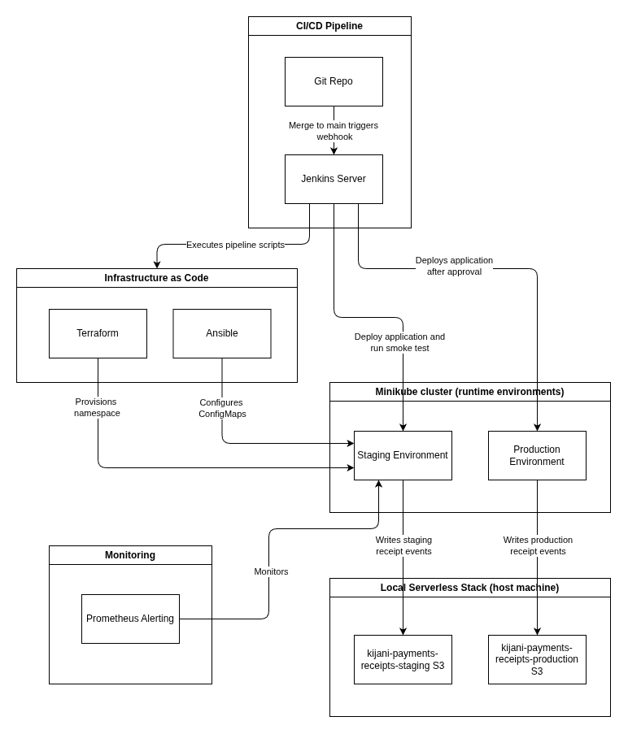

# KijaniKiosk DevOps Capstone: Automated CI/CD & Hybrid Cloud Deployment

## Project Overview

This capstone deploys the `kk-payments` Node.js service to staging and production
namespaces on one Minikube cluster. Jenkins runs the delivery pipeline,
Terraform manages the staging namespace, Ansible configures environment values,
and a local Serverless Framework stack simulates receipt processing and S3
events.

## Architecture

### 1. Delivery Pipeline (Jenkins CI/CD)

The Jenkins Configuration as Code creates one Pipeline job for the `main`
branch. It loads `kijani-capstone/Jenkinsfile` and:

* Validates Terraform and Ansible configuration.
* Configures and deploys the application to `kijani-staging`.
* Runs a smoke test against the staging `/health` endpoint.
* Waits at a manual approval step before deploying to the `default`
  (production) namespace.

The pipeline does not build or push the application image; build and update
the image tag in the Kubernetes deployment manifest before running it.

### 2. Kubernetes Environments

Staging and production run in separate namespaces on the same Minikube cluster.
NGINX Ingress routes `staging.kijani.local/payments/...` to staging and
`kijani.local/payments/...` to production. Terraform provisions the staging
namespace, and Ansible creates environment-specific ConfigMaps and Secrets.

### 3. Event-Driven Receipt Processing (Serverless)

The `kk-payments` service forwards receipt requests to the local Serverless
HTTP API. The `generateReceipt` handler writes receipt data to local S3
simulator buckets. S3 object-created events invoke the processor and notifier
handlers, which log their processing and dispatch events.

### 4. Log-Based Monitoring

The application writes a structured log for each completed request except
`/health` probes. `monitoring/error_rate.py` reads recent staging pod logs and
reports the 5xx rate for real `/receipts` requests against the Week 7 target
of fewer than 0.1%.

The staging-only `/simulate-traffic` route randomly returns HTTP 200 or 500.
`monitoring/trigger-incident.sh` generates synthetic traffic for testing; the
report keeps that traffic separate from real receipt requests. This is a
two-minute log sample, not a Prometheus alert or a rolling 30-day SLO
measurement.



## Technology Stack

* **CI/CD:** Jenkins, Jenkins Configuration as Code (JCasC), Job DSL
* **Infrastructure as Code:** Terraform, Ansible
* **Container Orchestration:** Kubernetes (Minikube), Docker, NGINX Ingress
* **Application:** Node.js 20, TypeScript, Express
* **Serverless:** Serverless Framework v3, AWS SDK v3
* **Local Simulators:** `serverless-offline`, `serverless-s3-local`
* **Monitoring:** Structured application logs, Python report script, `kubectl`

## Prerequisites

* Docker and Docker Compose
* Minikube and `kubectl` (with the ingress addon enabled)
* Terraform and Ansible for manual infrastructure setup
* Node.js 20.x and npm
* Python 3 for the log report
* GitHub repository access from Jenkins so it can check out the project

## Environment Setup & Configuration

### 1. Jenkins Configuration as Code (JCasC)

Jenkins configuration is in `jenkins-docker/`. From that directory, create and
edit the environment file:

```bash
cp .env.example .env
```

Set `HOST_HOME` to your absolute home-directory path, and use a non-default
`JENKINS_ADMIN_ID` and `JENKINS_ADMIN_PASSWORD`. Start or rebuild Jenkins:

```bash
docker compose up -d --build
```

The JCasC job is named `kijani-capstone-main`; it checks out `main` and loads
`kijani-capstone/Jenkinsfile`. For now, start builds manually from the Jenkins
UI. Automatic triggering on pushes to `main` is not connected yet; pushes and
merges alone will not start a build.

### 2. Local DNS Mapping

Enable the Minikube ingress addon, then add the Minikube IP and application
hostnames to your host machine's hosts file:

```text
<MINIKUBE_IP> staging.kijani.local
<MINIKUBE_IP> kijani.local
```

Get the address with:

```bash
minikube ip
```

## Running the Application

### Step 1: Start the Serverless Simulator

From the repository root:

```bash
cd kijani-capstone/kijani-serverless
npm install
npx serverless offline start --stage staging
```

Leave it running while testing receipts. The staging ConfigMap points
`kk-payments` to `http://host.minikube.internal:3000/receipts`; the local S3
simulator uses port `4569`.

### Step 2: Run the Jenkins Pipeline

1. Open Jenkins at `http://localhost:8080`.
2. Select and run the `kijani-capstone-main` job manually.
3. Check that the pipeline deploys to staging and passes its health smoke test.
4. Approve the manual production stage only when you intend to deploy to the
   `default` namespace.

The pipeline uses the public image tag already specified in
`k8s/kk-payments-deployment.yaml`; it does not build or push an image. The
current manifest references
`salyani123/kk-payments:1.0.0-structured-logs-20261113174805`. To use another
public image version, update that manifest tag before starting the pipeline.

### Step 3: Verify Receipt Processing

Send a uniquely identified test receipt to staging:

```bash
curl -i -X POST http://staging.kijani.local/payments/receipts \
  -H 'Content-Type: application/json' \
  -d '{"orderId":"TEST-RECEIPT-001","amount":100,"currency":"KES"}'
```

When the local simulator is available, the response should succeed. Check the
Serverless terminal for receipt generation, processing, and notification
events. Test requests may write objects to the staging local S3 simulator.

### Step 4: Test Synthetic Traffic and Review the Receipt Error Rate

From `kijani-capstone/`, send synthetic traffic to the staging-only endpoint:

```bash
./monitoring/trigger-incident.sh
```

The helper sends 50 requests to `/payments/simulate-traffic`, which randomly
returns HTTP 200 or 500 in staging. You can change the number with
`ERROR_TEST_REQUESTS` or override the URL with `STAGING_ERROR_URL`. Synthetic
requests are excluded from the receipt error-rate calculation.

To measure real receipt requests, send a batch of uniquely identified test
receipts through the staging `/payments/receipts` endpoint, then run from
`kijani-capstone/`:

```bash
python3 monitoring/error_rate.py
```

The report counts non-synthetic `/receipts` HTTP 5xx responses in staging pod
logs from the last two minutes, compares them with the Week 7 target of fewer
than 0.1%, prints the result, and writes
`monitoring/error-rate-summary.txt`. It reports `NO DATA` if no receipt
requests occurred during the window. A short sample demonstrates the
calculation but does not establish the rolling 30-day SLO.

## Project Structure

```text
.
├── ansible/                # Environment configuration and variables
├── docs/                   # Scope, architecture, and test plan
├── jenkins-docker/         # Jenkins image, plugins, Compose, and JCasC
├── k8s/                    # Kubernetes Deployment, Service, and Ingress
├── kijani-serverless/      # Receipt handlers and local Serverless setup
├── monitoring/             # Log report and synthetic staging test helper
├── terraform/              # Staging namespace configuration
└── Jenkinsfile             # CI/CD deployment pipeline
```
