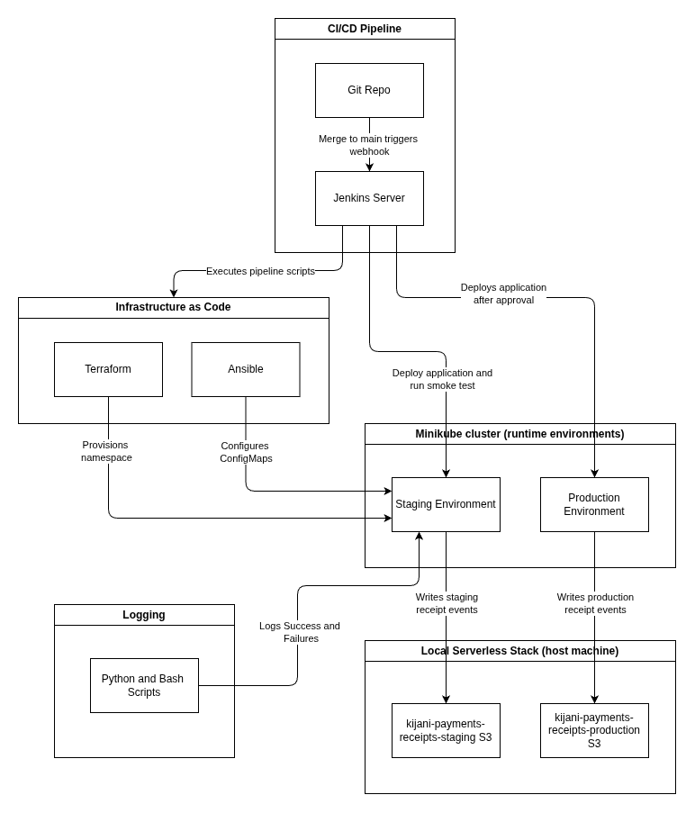

# Capstone Scope Document

## Problem Statement
The `kk-payments` microservice runs on a local Minikube cluster. Without a staging environment, changes are harder to validate before production deployment. This capstone separates staging from production using Kubernetes namespaces and a Jenkins pipeline, and adds a staging health check, approval gate, rollback attempt on staging failure, and log-based receipt error-rate report.

## Track
Track A (Infrastructure first)

## What I will build
- Terraform configuration to provision the `kijani-staging` Kubernetes namespace.
- Ansible playbooks and environment variables to configure staging and production ConfigMaps and Secrets.
- A Jenkins Pipeline job that reads `kijani-capstone/Jenkinsfile`, deploys changes to staging, and runs a health-check smoke test.
- A production approval gate so production deployment only proceeds after staging checks pass and an administrator approves.
- Jenkins failure handling that attempts to roll back a failed staging deployment or smoke test when a previous Deployment revision exists.
- Structured request logs and a script that reports the staging receipt HTTP 5xx rate over the last two minutes against the Week 7 target of fewer than 0.1%.
- A staging-only synthetic traffic endpoint and helper script to exercise and verify request logging.
- Integration between the staging `kk-payments` deployment and a local Serverless/S3 simulator for receipt processing.

## What Is Out Of Scope
- Multi-cluster Kubernetes architecture; staging and production use namespaces on one local Minikube cluster.
- Prometheus alerting and continuous alert notifications; monitoring is currently a manually run, two-minute log report, not a rolling 30-day SLO calculation.
- Production AWS S3/Lambda infrastructure; the receipt chain uses local simulators.
- Production-grade secret management, durable centralized log storage, and external alert delivery.

## Success Criteria
1. A reviewer can manually start the Jenkins job and observe IaC checks, staging configuration, deployment, and the health smoke test.
2. The pipeline waits for explicit administrator approval before deploying to production.
3. If staging deployment or its smoke test fails after a prior successful Deployment exists, Jenkins attempts to roll back and the pipeline does not proceed to production.
4. A staging receipt request is processed by the local Serverless/S3 simulator, and the log report summarizes the receipt 5xx rate when receipt request logs are available.

## Architecture Diagram

