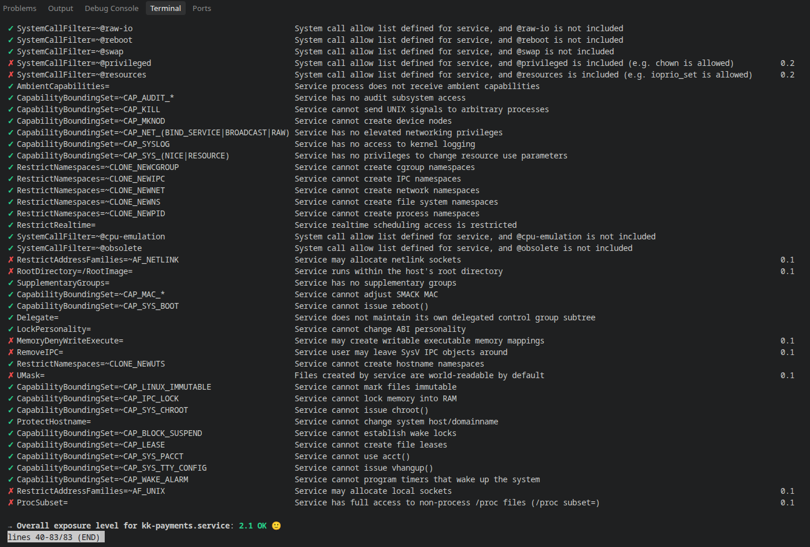

# KijaniKiosk Staging Environment Security Decisions

### Executive Overview
This week, our main goal was moving away from setting up servers by hand and relying on human memory. Instead, we have built a fully automated pipeline for the KijaniKiosk staging environment. When we present this to the board, we want them to know that our infrastructure is not just a collection of random settings, but a strict, version-controlled blueprint that any engineer on our team can read, review, and deploy. In this document, I will explain the security choices we made along the way to ensure our financial services are protected by default. 

I am also happy to share that during our final automated run, our main payment processing service achieved an exposure score of 2.1. This is a massive improvement, proving that our aggressive sandboxing techniques are actively working to restrict what the application is allowed to do.

### The Shift to Automated Infrastructure
Before this project, if a server crashed, we would have to look at old notes and try to manually click through the cloud provider dashboard to rebuild it. That approach is slow and leaves too much room for human error. The biggest decision we made this week was to define every single piece of our network and server hardware as code. 

By doing this, we guarantee that the staging environment is perfectly identical every single time it gets built. If a security rule needs to change, an engineer cannot just log in and change it secretly. They have to update the blueprint, have another team member review the code, and then push it through our automated pipeline. This gives KijaniKiosk a permanent, readable history of every infrastructure change. It also means we can tear down the entire environment over the weekend to save money, knowing we can bring it back up on Monday morning in exactly the same secure state.

### State Locking and Remote Memory
When you use an automated blueprint, the deployment engine needs a way to remember what it has already built. This memory is called the state. One of our core security decisions was moving this state off of our personal laptops and into a secure, centralized storage bucket in the cloud. 

However, moving this memory to the cloud introduces a new risk: what happens if two engineers try to run the deployment pipeline at the exact same second? To solve this, we implemented a strict state locking mechanism. Whenever the pipeline starts, it places a temporary lock on the environment. If someone else tries to deploy changes, the system sees the lock and forces them to wait until the first job finishes. This decision is critical for KijaniKiosk because it prevents our infrastructure from becoming corrupted by simultaneous updates. It guarantees that our deployments happen in an orderly, predictable queue, completely eliminating the risk of conflicting configuration changes breaking our staging environment.

### Application Sandboxing Strategy
Even with a perfect network, we have to assume that an attacker might eventually find a clever way to compromise the payment application itself. Because of this, we made the decision to heavily restrict the environment around the application. 

We placed the service in a tight sandbox. We mathematically stripped away its ability to ask the operating system for higher administrative rights. We also hid the physical hardware and completely blocked it from making any permanent changes to the core system files. By forcing the surrounding system to act as if it is entirely read-only, we ensure that if a bad actor takes over the application, they are trapped. They cannot install backdoors, they cannot peek at the temporary memory of other services running nearby, and they cannot alter the server to maintain their access.

### Security Control Matrix
The following table outlines the specific technical controls we applied during this project and the business risks they are designed to solve.

| Control | What it does | Risk mitigated |
| :--- | :--- | :--- |
| Network Firewalls | Restricts incoming traffic to specific application ports and known administrative locations. | Prevents unauthorized network access, data exfiltration, and automated vulnerability scanning attacks. |
| Cryptographic Access Keys | Requires complex mathematical keys for administrative server entry rather than standard passwords. | Mitigates brute-force password guessing and unauthorized administrative access by external threat actors. |
| Centralized Deployment State | Stores the infrastructure blueprint securely in a managed remote location rather than a local workstation. | Prevents unauthorized tampering of infrastructure memory and ensures full auditability of the environment. |
| State Lock Management | Acts as a strict queuing system that prevents simultaneous infrastructure deployment attempts. | Avoids infrastructure corruption, partial deployments, and catastrophic data loss during concurrent updates. |
| File System Protections | Forces the core operating system directories to appear read-only to the running KijaniKiosk application. | Stops malicious software from permanently installing itself, altering configurations, or modifying the server. |
| Privilege Escalation Prevention | Blocks the application process from requesting or obtaining higher administrative rights from the operating system. | Contains security breaches strictly to the specific service compromised, protecting the wider server environment. |
| Device and Kernel Isolation | Hides physical hardware interfaces and the core operating system engine from the running application. | Prevents deep system compromise and restricts access to highly sensitive, low-level system functions. |
| Temporary Storage Isolation | Provides the application service with a unique, completely isolated temporary data scratchpad. | Prevents cross-service data snooping, memory manipulation, and shared resource exploitation. |

### Unmitigated Risks
While I am very proud of the technical guardrails we put in place this week, it is important to be honest about what these decisions do not cover. Our current pipeline strictly secures the underlying servers and the network boundaries, but it does not protect us from flaws inside the actual KijaniKiosk application code. For example, if there is a bug in how we process a payment logic flow, or if our user authentication system has a vulnerability, these infrastructure controls cannot stop an attacker from exploiting it. Additionally, we have not yet set up defenses against massive floods of fake internet traffic designed to knock our services offline. Finally, no technical lock can prevent someone from tricking one of our administrators into handing over their access keys. These are gaps we will need to address in future development cycles.